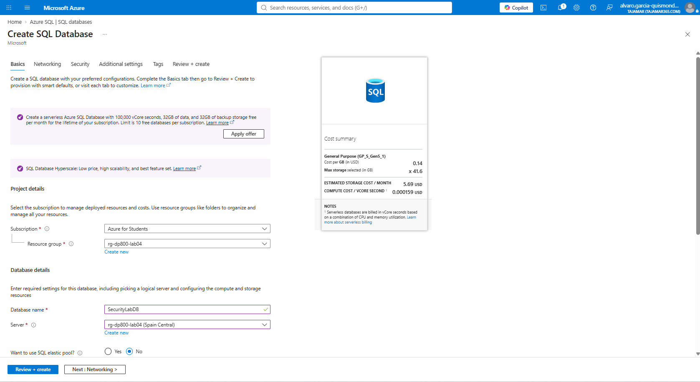
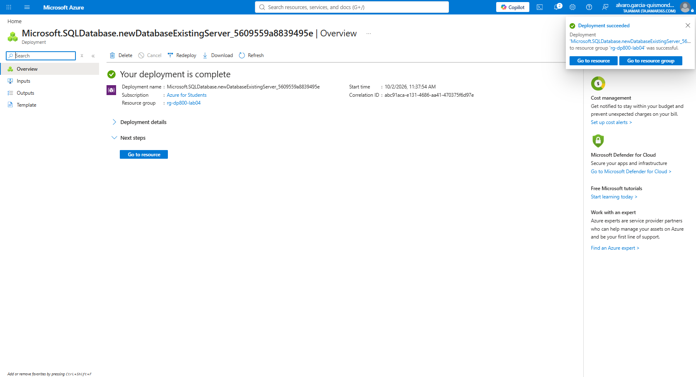
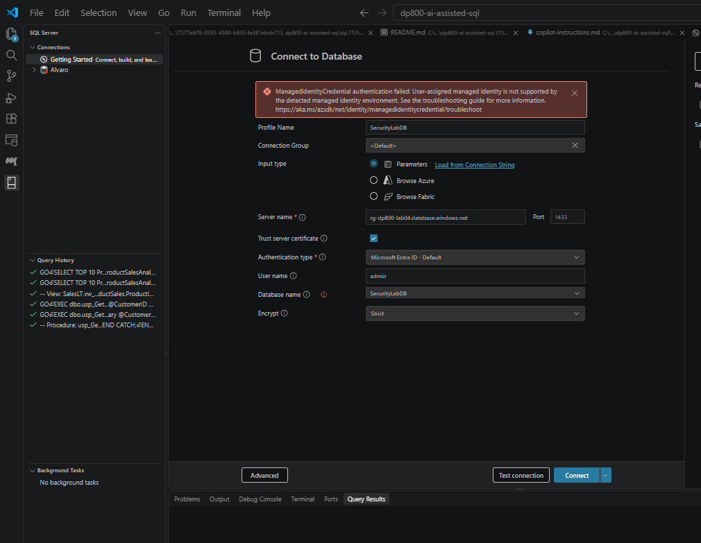
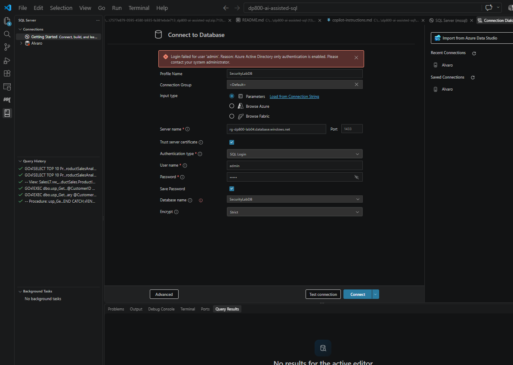
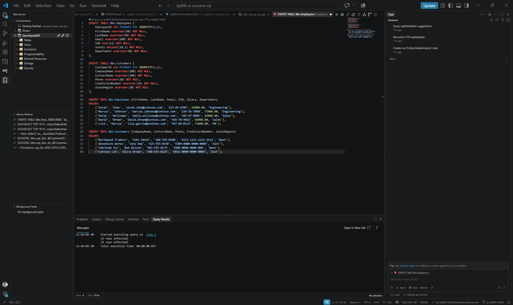
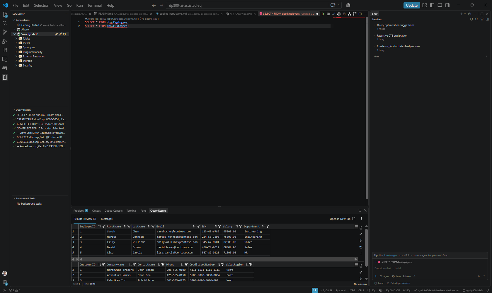
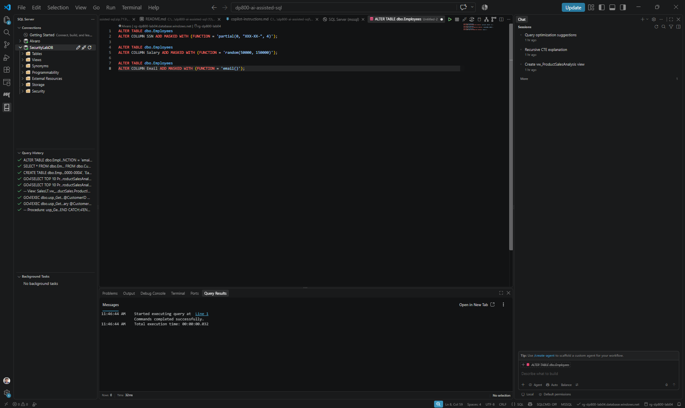
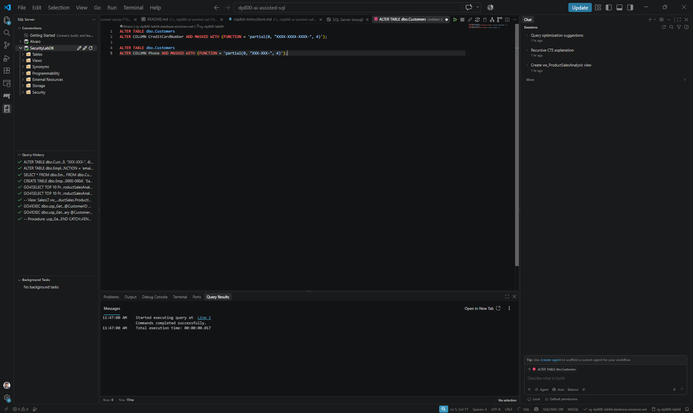
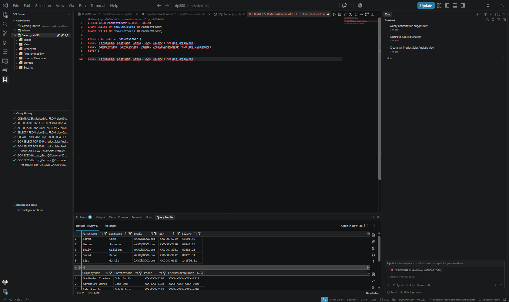
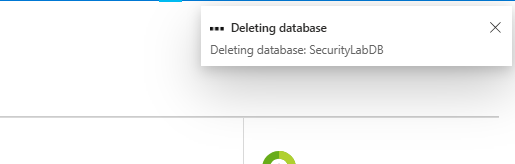

# Implementación de seguridad y cumplimiento en SQL

Álvaro García-Quismondo Lizana  
DP-800 · Máster en IA y Big Data · Tajamar  
2 de octubre de 2026

## 1. Creación de la base de datos

Creé la base de datos SecurityLabDB desde el portal de Azure, en la suscripción Azure for Students y dentro del grupo de recursos rg-dp800-lab04. En el campo Server elegí el servidor rg-dp800-lab04, de Spain Central (Figura 1).



Figura 1. Pestaña Basics con SecurityLabDB sobre el servidor rg-dp800-lab04.

> Nota: El enunciado pide crear un servidor nuevo con autenticación SQL. Reutilicé un servidor que ya existía, y con un servidor existente la pestaña Networking de la base de datos no ofrece el método de conectividad, así que esa parte del enunciado no la apliqué.

El despliegue terminó sin errores (Figura 2).



Figura 2. Despliegue de la base de datos completado.

## 2. Conexión desde Visual Studio Code

En la extensión SQL Server (mssql) creé un perfil llamado SecurityLabDB que apunta a rg-dp800-lab04.database.windows.net, con Trust server certificate activado. El primer intento fue con Microsoft Entra ID - Default y falló porque no se detectó una identidad administrada (Figura 3).



Figura 3. Error de conexión con Microsoft Entra ID - Default: identidad administrada no admitida.

El segundo intento fue con SQL Login y el usuario admin. También falló, porque el servidor solo admite autenticación de Azure Active Directory (Figura 4).



Figura 4. Error de conexión con SQL Login: solo está habilitada la autenticación de Azure Active Directory.

> Nota: El enunciado da por hecha la autenticación SQL. En este servidor no era posible, así que conecté con autenticación de Microsoft Entra ID. Las capturas siguientes muestran SecurityLabDB conectada en el panel lateral.

## 3. Tablas y datos de ejemplo

Con la conexión activa abrí una consulta nueva y ejecuté el script que crea dbo.Employees y dbo.Customers y les inserta cinco empleados y cuatro clientes.

```sql
CREATE TABLE dbo.Employees (
    EmployeeID int PRIMARY KEY IDENTITY(1,1),
    FirstName nvarchar(50) NOT NULL,
    LastName nvarchar(50) NOT NULL,
    Email nvarchar(100) NOT NULL,
    SSN char(11) NOT NULL,
    Salary decimal(18,2) NOT NULL,
    Department nvarchar(50) NOT NULL
);

CREATE TABLE dbo.Customers (
    CustomerID int PRIMARY KEY IDENTITY(1,1),
    CompanyName nvarchar(100) NOT NULL,
    ContactName nvarchar(100) NOT NULL,
    Phone nvarchar(20) NOT NULL,
    CreditCardNumber nvarchar(19) NOT NULL,
    SalesRegion nvarchar(20) NOT NULL
);

INSERT INTO dbo.Employees (FirstName, LastName, Email, SSN, Salary, Department)
VALUES
    ('Sarah', 'Chen', 'sarah.chen@contoso.com', '123-45-6789', 95000.00, 'Engineering'),
    ('Marcus', 'Johnson', 'marcus.johnson@contoso.com', '234-56-7890', 75000.00, 'Engineering'),
    ('Emily', 'Williams', 'emily.williams@contoso.com', '345-67-8901', 82000.00, 'Sales'),
    ('David', 'Brown', 'david.brown@contoso.com', '456-78-9012', 68000.00, 'Sales'),
    ('Lisa', 'Garcia', 'lisa.garcia@contoso.com', '567-89-0123', 71000.00, 'HR');

INSERT INTO dbo.Customers (CompanyName, ContactName, Phone, CreditCardNumber, SalesRegion)
VALUES
    ('Northwind Traders', 'John Smith', '206-555-0100', '4111-1111-1111-1111', 'West'),
    ('Adventure Works', 'Jane Doe', '425-555-0150', '5500-0000-0000-0004', 'East'),
    ('Fabrikam Inc', 'Bob Wilson', '503-555-0175', '3400-0000-0000-009', 'West'),
    ('Contoso Ltd', 'Alice Brown', '360-555-0125', '6011-0000-0000-0004', 'East');
```

El panel de mensajes devolvió 5 filas afectadas y 4 filas afectadas (Figura 5).



Figura 5. Script de tablas y datos ejecutado.

Para comprobar el contenido ejecuté dos SELECT sobre las tablas. Esta consulta no está en el enunciado (Figura 6).

```sql
SELECT * FROM dbo.Employees;
SELECT * FROM dbo.Customers;
```



Figura 6. Contenido de Employees y Customers tras la inserción.

## 4. Dynamic Data Masking

### 4.1 Máscaras en Employees

Añadí tres máscaras a Employees: partial en SSN para dejar visibles solo los cuatro últimos dígitos, random entre 50000 y 150000 en Salary y la función email() en Email.

```sql
ALTER TABLE dbo.Employees
ALTER COLUMN SSN ADD MASKED WITH (FUNCTION = 'partial(0, "XXX-XX-", 4)');

ALTER TABLE dbo.Employees
ALTER COLUMN Salary ADD MASKED WITH (FUNCTION = 'random(50000, 150000)');

ALTER TABLE dbo.Employees
ALTER COLUMN Email ADD MASKED WITH (FUNCTION = 'email()');
```



Figura 7. Máscaras añadidas a SSN, Salary y Email; el panel indica Commands completed successfully.

### 4.2 Máscaras en Customers

En Customers enmascaré CreditCardNumber y Phone con partial, de modo que solo se vean los cuatro últimos caracteres.

```sql
ALTER TABLE dbo.Customers
ALTER COLUMN CreditCardNumber ADD MASKED WITH (FUNCTION = 'partial(0, "XXXX-XXXX-XXXX-", 4)');

ALTER TABLE dbo.Customers
ALTER COLUMN Phone ADD MASKED WITH (FUNCTION = 'partial(0, "XXX-XXX-", 4)');
```



Figura 8. Máscaras añadidas a CreditCardNumber y Phone; el panel indica Commands completed successfully.

### 4.3 Comprobación con un usuario sin UNMASK

Creé el usuario MaskedViewer sin login, le di SELECT sobre las dos tablas y lancé las consultas con EXECUTE AS. El script termina con una consulta como administrador.

```sql
CREATE USER MaskedViewer WITHOUT LOGIN;
GRANT SELECT ON dbo.Employees TO MaskedViewer;
GRANT SELECT ON dbo.Customers TO MaskedViewer;

EXECUTE AS USER = 'MaskedViewer';
SELECT FirstName, LastName, Email, SSN, Salary FROM dbo.Employees;
SELECT CompanyName, ContactName, Phone, CreditCardNumber FROM dbo.Customers;
REVERT;

SELECT FirstName, LastName, Email, SSN, Salary FROM dbo.Employees;
```

En la Figura 9, MaskedViewer ve el SSN como XXX-XX-6789 y el correo de Sarah Chen como sXXX@XXXX.com. El salario aparece con valores aleatorios, por ejemplo 58591.42 en la primera fila. En Customers, el teléfono de Northwind Traders sale como XXX-XXX-0100 y su tarjeta como XXXX-XXXX-XXXX-1111. La tarjeta de Fabrikam Inc se lee XXXX-XXXX-XXXX--009, con dos guiones, porque el dato original tiene 18 caracteres y los cuatro últimos empiezan por guion.



Figura 9. Resultados de las dos consultas ejecutadas como MaskedViewer.

La tercera consulta, la del administrador sin máscara, generó una tercera tabla de resultados de la que no guardé captura.

## 5. Row-Level Security

Ejecuté los pasos del enunciado para Row-Level Security. No conservo capturas de este apartado, por eso incluyo solo el código que ejecuté.

### 5.1 Usuarios por región

Creé WestSalesRep y EastSalesRep sin login y les di SELECT sobre dbo.Customers.

```sql
CREATE USER WestSalesRep WITHOUT LOGIN;
CREATE USER EastSalesRep WITHOUT LOGIN;

GRANT SELECT ON dbo.Customers TO WestSalesRep;
GRANT SELECT ON dbo.Customers TO EastSalesRep;
```

### 5.2 Función de filtro y política de seguridad

Creé el esquema Security y la función Security.fn_RegionFilter, que compara SalesRegion con la región asociada al usuario y deja pasar todas las filas a los miembros de db_owner. Después creé la política CustomerRegionPolicy sobre dbo.Customers.

```sql
CREATE SCHEMA Security;
GO

CREATE FUNCTION Security.fn_RegionFilter(@SalesRegion nvarchar(20))
RETURNS TABLE
WITH SCHEMABINDING
AS
RETURN SELECT 1 AS AccessGranted
    WHERE @SalesRegion =
        CASE USER_NAME()
            WHEN 'WestSalesRep' THEN 'West'
            WHEN 'EastSalesRep' THEN 'East'
            ELSE @SalesRegion
        END
       OR IS_MEMBER('db_owner') = 1;
GO

CREATE SECURITY POLICY CustomerRegionPolicy
ADD FILTER PREDICATE Security.fn_RegionFilter(SalesRegion)
    ON dbo.Customers
WITH (STATE = ON);
```

### 5.3 Pruebas por usuario

Consulté dbo.Customers como WestSalesRep, como EastSalesRep y como administrador.

```sql
EXECUTE AS USER = 'WestSalesRep';
SELECT * FROM dbo.Customers;
REVERT;

EXECUTE AS USER = 'EastSalesRep';
SELECT * FROM dbo.Customers;
REVERT;

SELECT * FROM dbo.Customers;
```

## 6. Limpieza

### 6.1 Objetos SQL

Ejecuté el script de limpieza del enunciado, que elimina la política, la función, el esquema, los usuarios de prueba y las dos tablas. No conservo captura de este paso.

```sql
DROP SECURITY POLICY IF EXISTS CustomerRegionPolicy;
DROP FUNCTION IF EXISTS Security.fn_RegionFilter;
DROP SCHEMA IF EXISTS Security;

DROP USER IF EXISTS MaskedViewer;
DROP USER IF EXISTS WestSalesRep;
DROP USER IF EXISTS EastSalesRep;

DROP TABLE IF EXISTS dbo.Customers;
DROP TABLE IF EXISTS dbo.Employees;
```

### 6.2 Base de datos

Borré SecurityLabDB desde el portal de Azure. La notificación muestra el borrado en curso (Figura 10).



Figura 10. Notificación de borrado de SecurityLabDB.

> Nota: El enunciado indica borrar el grupo de recursos. Como rg-dp800-lab04 ya existía y contiene el servidor que reutilicé, eliminé solo la base de datos que creé yo.

## 7. Conclusión

La conexión con usuario y contraseña no funcionó porque el servidor solo admite Entra ID, y tuve que cambiar de método de autenticación. Las máscaras se comprobaron con un usuario sin UNMASK y el resultado se ve en la Figura 9. De Row-Level Security y de la limpieza de objetos SQL no conservo capturas, así que esos apartados no tienen evidencia gráfica.
